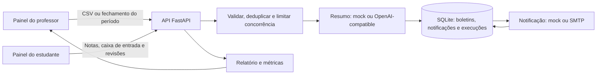

# Automated Grade Report Dispatcher

Aplicação full-stack para importar notas, gerar boletins personalizados e
notificar estudantes. O projeto usa **Python 3.13 + FastAPI** no backend e
**React + Next.js** no frontend.

## Requisitos

Instale estes pré-requisitos antes de iniciar:

| Requisito | Versão | Link |
| --- | --- | --- |
| Python | 3.13 | [Download do Python](https://www.python.org/downloads/) · [Instalação](https://docs.python.org/3/using/index.html) |
| Node.js | 20.9 ou superior | [Download do Node.js](https://nodejs.org/en/download) |
| pnpm | 11.4.0 | [Instalação do pnpm](https://pnpm.io/installation) |
| Git | Recomendado | [Download do Git](https://git-scm.com/downloads) |

O script de inicialização também utiliza Bash, `curl`, `lsof` e `shasum`. No
macOS, esses utilitários já estão disponíveis. No Linux, instale `curl` e
`lsof` pelo gerenciador de pacotes da distribuição. Não é necessário instalar
Docker, criar ambientes virtuais manualmente ou instalar as dependências à
mão: o script prepara o ambiente quando necessário.

## Iniciar a aplicação

Na raiz do repositório, execute:

```bash
./scripts/dev.sh
```

Ou, se preferir usar o Make:

```bash
make dev
```

Na primeira execução, o script cria o ambiente virtual Python em `.venv`,
instala as dependências do backend e do frontend, e cria `backend/.env` com
segredos locais aleatórios se esse arquivo ainda não existir. Depois, inicia
a API e o painel:

- **Painel web:** [http://localhost:3000](http://localhost:3000)
- **Documentação interativa da API:** [http://127.0.0.1:8000/docs](http://127.0.0.1:8000/docs)

O script mantém os dois serviços no mesmo terminal. Pressione **Ctrl+C** para
encerrar ambos. Para verificar portas já ocupadas, dependências e preparação,
consulte `./scripts/dev.sh --preflight` e `make setup`.

O login local oferece os perfis de demonstração **professor**, **aluno 1** e
**aluno 2**. Não use o modo de contas de demonstração fora de um ambiente
local confiável.

### Outros comandos

| Comando | Ação |
| --- | --- |
| `make dev` | Prepara o ambiente e inicia API e painel, sem executar testes. |
| `make ci` | Executa testes, cobertura, typecheck e lint; inicia os serviços se tudo passar. |
| `make check` | Executa as mesmas verificações, sem iniciar os serviços. |
| `make setup` | Prepara o ambiente e o `.env` local, sem iniciar os serviços. |
| `BACKEND_PORT=8010 FRONTEND_PORT=3010 make dev` | Inicia os serviços em outras portas. |
| `DATABASE_URL=sqlite:////tmp/demo.db make dev` | Usa um banco SQLite temporário. |
| `API_LOG=/tmp/api.log make dev` | Também grava o log JSON da API no arquivo indicado. |

O script confere as portas antes de iniciar e não permite abrir duas instâncias
`next dev` deste projeto ao mesmo tempo.

## Configuração local e provedores

O padrão é adequado para uma demonstração local, sem chaves ou serviços
externos:

```env
GRADE_SUMMARY_PROVIDER=mock
GRADE_NOTIFICATION_PROVIDER=mock
```

As configurações estão documentadas em
[`backend/.env.example`](backend/.env.example). O script cria
`backend/.env` automaticamente; esse arquivo contém segredos locais e não deve
ser enviado ao repositório.

Para usar um provedor OpenAI-compatible, configure
`GRADE_SUMMARY_PROVIDER=openai`, `OPENAI_API_KEY` e `OPENAI_MODEL`. Para enviar
e-mails por SMTP, configure `GRADE_NOTIFICATION_PROVIDER=smtp`, `SMTP_HOST`,
`SMTP_FROM` e as opções de TLS/autenticação correspondentes. Os valores de
preço de tokens do exemplo são ilustrativos: confira os preços atuais do modelo
antes de configurar `LLM_INPUT_USD_PER_1K_TOKENS` e
`LLM_OUTPUT_USD_PER_1K_TOKENS`.

Para testar o adaptador HTTP sem chamar um serviço pago, é possível iniciar o
servidor LLM falso descrito em [`backend/scripts/fake_llm.py`](backend/scripts/fake_llm.py);
o [guia de testes](docs/GUIA_DE_TESTES.md) explica os cenários.

## Demonstração rápida

1. Inicie a aplicação com `./scripts/dev.sh`.
2. Entre como **professor** no painel.
3. Envie [`backend/notas_mock.csv`](backend/notas_mock.csv). O arquivo inclui
   exemplos de nota fora do intervalo e ID duplicado.
4. Consulte o relatório de execução e envie o arquivo novamente para observar
   o cache.
5. Para experimentar o fluxo de fechamento de período letivo, acesse a página
   **Semestres**, crie um período e use **Fechar e notificar**.
6. Entre como estudante para consultar o boletim e as notificações recebidas.

O guia detalhado de validação automática e demonstração manual de cada critério
está em [`docs/GUIA_DE_TESTES.md`](docs/GUIA_DE_TESTES.md).

## O que a aplicação faz

### Despacho de boletins

O professor envia um CSV com o cabeçalho
`id_aluno,nome,email,nota_matematica,nota_historia`. O serviço valida UUID,
nome, e-mail e notas de 0 a 20; informa linhas inválidas, campos ausentes e
duplicidades; gera um resumo personalizado; e entrega uma notificação pelo
provedor selecionado. O relatório inclui processados, falhas, cache,
duplicados, tokens, custo estimado e latência.

O upload pode ser síncrono ou assíncrono (`POST /upload?mode=async`). No modo
assíncrono, a API responde `202 Accepted` e o painel acompanha a execução por
`GET /executions/{execution_id}`.

### Fechamento do período e experiência do estudante

O professor pode criar e fechar períodos letivos na página **Semestres**.
Ao fechar um período, o serviço gera ou reutiliza o resumo de cada estudante,
registra a notificação na caixa de entrada e tenta enviar o e-mail. Falhas de
e-mail podem ser reprocessadas pelo fluxo de reenvio de pendentes.

Estudantes podem consultar as próprias notas, notificações e pedidos de
revisão. Professores podem gerir o cadastro, analisar pedidos, ajustar notas e
acompanhar métricas e histórico de execuções.

## Funcionalidades do painel

- **Professor:** importa CSV, gerencia estudantes e períodos, decide pedidos
  de revisão e acompanha execuções e métricas.
- **Estudante:** consulta notas e notificações e solicita revisão de nota.

O painel exibe dados da API conforme o perfil autenticado.

## Arquitetura



O projeto é um **monólito modular**, organizado em camadas: rotas HTTP,
schemas, serviços de aplicação, regras de domínio e repositórios. Nas
integrações, usa princípios de **arquitetura hexagonal (Ports and Adapters)**:
contratos como `ISummarizer`, `INotifier`, `IGradeReportRepository` e
`ITermClosingRepository` separam o fluxo de negócio dos provedores concretos.
O frontend Next.js funciona como painel e **BFF/proxy** para a API. A
persistência padrão é SQLite; provedores mock e externos implementam as mesmas
interfaces.

### Confiabilidade, limites e custo

- O processamento limita concorrência por lote e chamadas aos provedores.
- Erros transitórios de provedores são retentados com backoff; circuit
  breakers evitam insistir em serviços indisponíveis.
- Um resumo pendente pode ser reutilizado ao tentar novamente um envio falho,
  evitando nova chamada ao LLM.
- Cache por estudante e notas evita trabalho repetido; um teto de custo por
  execução pode encaminhar os casos seguintes ao resumo por template.
- A saída do LLM é validada antes de ser usada; em caso de falha, há fallback
  determinístico por template.
- Logs JSON incluem IDs de correlação e métricas, mascaram e-mails e não
  registram o texto do boletim.
- `GET /metrics` reúne métricas do dispatcher, métricas operacionais e
  execuções recentes. `GET /executions` lista o histórico; `GET
  /executions/{execution_id}` consulta uma execução.

O envio de e-mail é *at-least-once*, não exatamente uma vez: uma interrupção
depois de o SMTP aceitar a mensagem e antes da gravação de sucesso pode gerar
um reenvio. Os limites de concorrência, rate limiting e circuit breakers são
por processo. O modo assíncrono usa tarefas em memória, que podem ser perdidas
se o servidor reiniciar. Essas decisões são apropriadas para a demonstração;
uma implantação horizontal exigiria fila durável, outbox, banco compartilhado
e coordenação distribuída.

## Testes e qualidade

Execute todas as verificações a partir da raiz:

```bash
make check
```

O comando roda a suíte Python com cobertura, os testes Vitest do frontend,
typecheck de TypeScript e ESLint. Também é possível executar os testes
separadamente:

```bash
(cd backend && ../.venv/bin/python -m pytest -q tests)
(cd frontend && pnpm test)
```

Os testes não dependem de chamadas reais ao LLM ou ao SMTP. O
[guia de testes](docs/GUIA_DE_TESTES.md) descreve os cenários de validação.

## Endpoints da API

API FastAPI; `/docs` lista parâmetros, schemas e respostas.

| Grupo | Método e rota | Para que serve |
| --- | --- | --- |
| Autenticação (4) | `POST /auth/login` | Inicia sessão de demonstração do professor ou estudante. |
|  | `POST /auth/refresh` | Rotaciona o refresh token e emite um novo par de tokens. |
|  | `POST /auth/logout` | Revoga o refresh token. |
|  | `GET /auth/me` | Retorna a identidade associada ao access token. |
| Despacho e execuções (3) | `POST /upload` | Valida e processa CSV; síncrono por padrão ou assíncrono com `mode=async`. |
|  | `GET /executions` | Lista as execuções recentes do dispatcher. |
|  | `GET /executions/{execution_id}` | Consulta estado e relatório de uma execução. |
| Métricas (1) | `GET /metrics` | Retorna métricas do dispatcher, operação e execuções recentes. |
| Estudantes (7) | `POST /students/` | Cadastra um estudante. |
|  | `GET /students/` | Lista estudantes com paginação. |
|  | `GET /students/under-review` | Lista estudantes com pedidos de revisão pendentes. |
|  | `GET /students/me` | Retorna o cadastro do estudante autenticado. |
|  | `GET /students/{student_id}` | Consulta um estudante específico. |
|  | `PUT /students/{student_id}` | Atualiza os dados de um estudante. |
|  | `DELETE /students/{student_id}` | Remove um estudante. |
| Revisões de nota (5) | `POST /reviews/` | Estudante solicita revisão de uma nota. |
|  | `GET /reviews/me` | Estudante consulta os próprios pedidos. |
|  | `GET /reviews/` | Professor lista pedidos pendentes. |
|  | `PATCH /reviews/{review_id}/decision` | Professor aprova ou rejeita um pedido e registra a decisão. |
|  | `DELETE /reviews/{review_id}` | Professor exclui um pedido pendente. |
| Períodos letivos (6) | `GET /terms` | Lista períodos letivos. |
|  | `POST /terms` | Cria um período letivo. |
|  | `PUT /terms/{term_id}` | Atualiza um período ainda editável. |
|  | `DELETE /terms/{term_id}` | Exclui um período que pode ser removido. |
|  | `POST /terms/{term_id}/close` | Fecha o período e gera/envia boletins personalizados. |
|  | `GET /terms/{term_id}/notifications` | Consulta as entregas de notificação do período. |
| Notificações do estudante (3) | `GET /notifications/me` | Lista a caixa de entrada do estudante autenticado. |
|  | `POST /notifications/me/read-all` | Marca todas as notificações do estudante como lidas. |
|  | `PATCH /notifications/{notification_id}/read` | Marca uma notificação própria como lida. |

Operações protegidas exigem token de acesso e autorização conforme o papel.

### Envelope de resposta

Respostas usam um envelope comum:

```json
{
  "success": true,
  "data": {},
  "pagination": null,
  "errors": null
}
```

`data` contém o resultado. Em listas paginadas, `pagination` informa página,
tamanho, total de registros e páginas e indicadores de navegação. Schemas usam
chaves `camelCase`.

Erros usam `success: false`, `data: []` e `errors`, com campo, código e
mensagem quando aplicável. O status HTTP identifica a classe do erro.

```json
{
  "success": false,
  "data": [],
  "pagination": null,
  "errors": [
    {
      "field": "studentId",
      "code": "BUSINESS_RULE_VIOLATION",
      "message": "O identificador já está cadastrado."
    }
  ]
}
```

### Erros de negócio e erros do sistema

- **Negócio:** conflito ou regra violada (`403`, `404` ou `409`).
- **Validação:** entrada incompatível com o schema (`422`); erros de linhas
  CSV também aparecem no relatório da execução.
- **Sistema:** falha técnica (`5xx`). `500` retorna mensagem genérica e registra
  detalhes nos logs com o ID da requisição. Em falhas transitórias, respeite
  `Retry-After` quando enviado.

### Segurança e controles

Controles implementados para a demonstração:

- JWT com access/refresh tokens; refresh rotacionável e revogável.
- Senhas com PBKDF2-HMAC-SHA256 (310.000 iterações).
- Cookies `HttpOnly`, `SameSite=Lax` e `Secure` em produção; validação de
  origem nas rotas de sessão. O JavaScript do frontend não acessa os tokens.
- Autorização por papel e escopo, CORS por origem e rate limiting para login,
  uploads, fechamento de período e provedores.
- Validação e limite de tamanho do CSV. Logs mascaram e-mails e não registram
  o texto dos boletins.

Contas de demonstração e modo mock são para uso local. Rate limits e circuit
breakers são por processo; SQLite e tarefas assíncronas em memória não
oferecem coordenação distribuída nem fila durável.

## Melhorias e implantação em AWS

As evoluções abaixo não estão implementadas. A aplicação pode continuar como
monólito modular, extraindo workers apenas quando necessário:

- **Dados e escala:** substituir SQLite por PostgreSQL e compartilhar rate
  limits/circuit breakers em Redis.
- **Processamento:** usar uma fila durável e workers separados. RabbitMQ atende
  o fluxo atual; Kafka só se justifica com necessidade de retenção,
  reprocessamento ou múltiplos consumidores independentes. Outbox e
  idempotência reduzem inconsistências e envios duplicados.
- **Resiliência e operação:** oferecer geração por template sem LLM; adicionar
  WebSocket ou SSE para atualizações; instrumentar tracing com OpenTelemetry e
  métricas com Prometheus.
- **API do painel:** manter REST para autenticação, escrita, uploads e
  execuções. Adicionar GraphQL para consultas agregadas de leitura, como a
  visão geral do professor ou do estudante. O Next.js/BFF consumiria esse
  endpoint; resolvers devem reutilizar serviços de aplicação, aplicar
  autorização por papel/escopo e limitar consultas custosas e N+1.