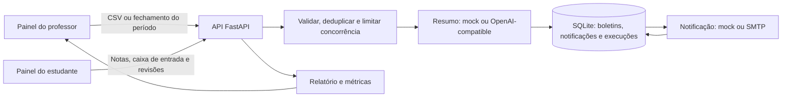

# Automated Grade Report Dispatcher

Aplicação full-stack para importar notas, gerar boletins personalizados e
notificar estudantes. O projeto usa **Python 3.13 + FastAPI** no backend e
**React + Next.js** no frontend.

## Requisitos

Instale estes pré-requisitos antes de iniciar:

| Requisito | Versão | Link |
| --- | --- | --- |
| Python | 3.13 | [Download do Python](https://www.python.org/downloads/) · [Instalação](https://docs.python.org/3/using/index.html) |
| Node.js | 20.9 ou superior | [Download do Node.js](https://nodejs.org/en/download) |
| pnpm | 11.4.0 | [Instalação do pnpm](https://pnpm.io/installation) |
| Git | Recomendado | [Download do Git](https://git-scm.com/downloads) |

O script de inicialização também utiliza Bash, `curl`, `lsof` e `shasum`. No
macOS, esses utilitários já estão disponíveis. No Linux, instale `curl` e
`lsof` pelo gerenciador de pacotes da distribuição. Não é necessário instalar
Docker, criar ambientes virtuais manualmente ou instalar as dependências à
mão: o script prepara o ambiente quando necessário.

## Iniciar a aplicação

Na raiz do repositório, execute:

```bash
./scripts/dev.sh
```

Ou, se preferir usar o Make:

```bash
make dev
```

Na primeira execução, o script cria o ambiente virtual Python em `.venv`,
instala as dependências do backend e do frontend, e cria `backend/.env` com
segredos locais aleatórios se esse arquivo ainda não existir. Depois, inicia
a API e o painel:

- **Painel web:** [http://localhost:3000](http://localhost:3000)
- **Documentação interativa da API:** [http://127.0.0.1:8000/docs](http://127.0.0.1:8000/docs)

O script mantém os dois serviços no mesmo terminal. Pressione **Ctrl+C** para
encerrar ambos. Para verificar portas já ocupadas, dependências e preparação,
consulte `./scripts/dev.sh --preflight` e `make setup`.

O login local oferece os perfis de demonstração **professor**, **aluno 1** e
**aluno 2**. Não use o modo de contas de demonstração fora de um ambiente
local confiável.

### Outros comandos

| Comando | Ação |
| --- | --- |
| `make dev` | Prepara o ambiente e inicia API e painel, sem executar testes. |
| `make ci` | Executa testes, cobertura, typecheck e lint; inicia os serviços se tudo passar. |
| `make check` | Executa as mesmas verificações, sem iniciar os serviços. |
| `make setup` | Prepara o ambiente e o `.env` local, sem iniciar os serviços. |
| `BACKEND_PORT=8010 FRONTEND_PORT=3010 make dev` | Inicia os serviços em outras portas. |
| `DATABASE_URL=sqlite:////tmp/demo.db make dev` | Usa um banco SQLite temporário. |
| `API_LOG=/tmp/api.log make dev` | Também grava o log JSON da API no arquivo indicado. |

O script confere as portas antes de iniciar e não permite abrir duas instâncias
`next dev` deste projeto ao mesmo tempo.

## Configuração local e provedores

O padrão é adequado para uma demonstração local, sem chaves ou serviços
externos:

```env
GRADE_SUMMARY_PROVIDER=mock
GRADE_NOTIFICATION_PROVIDER=mock
```

As configurações estão documentadas em
[`backend/.env.example`](backend/.env.example). O script cria
`backend/.env` automaticamente; esse arquivo contém segredos locais e não deve
ser enviado ao repositório.

Para usar um provedor OpenAI-compatible, configure
`GRADE_SUMMARY_PROVIDER=openai`, `OPENAI_API_KEY` e `OPENAI_MODEL`. Para enviar
e-mails por SMTP, configure `GRADE_NOTIFICATION_PROVIDER=smtp`, `SMTP_HOST`,
`SMTP_FROM` e as opções de TLS/autenticação correspondentes. Os valores de
preço de tokens do exemplo são ilustrativos: confira os preços atuais do modelo
antes de configurar `LLM_INPUT_USD_PER_1K_TOKENS` e
`LLM_OUTPUT_USD_PER_1K_TOKENS`.

Para testar o adaptador HTTP sem chamar um serviço pago, é possível iniciar o
servidor LLM falso descrito em [`backend/scripts/fake_llm.py`](backend/scripts/fake_llm.py);
o [guia de testes](docs/GUIA_DE_TESTES.md) explica os cenários.

## Demonstração rápida

1. Inicie a aplicação com `./scripts/dev.sh`.
2. Entre como **professor** no painel.
3. Envie [`backend/notas_mock.csv`](backend/notas_mock.csv). O arquivo inclui
   exemplos de nota fora do intervalo e ID duplicado.
4. Consulte o relatório de execução e envie o arquivo novamente para observar
   o cache.
5. Para experimentar o fluxo de fechamento de período letivo, acesse a página
   **Semestres**, crie um período e use **Fechar e notificar**.
6. Entre como estudante para consultar o boletim e as notificações recebidas.

O guia detalhado de validação automática e demonstração manual de cada critério
está em [`docs/GUIA_DE_TESTES.md`](docs/GUIA_DE_TESTES.md).

## O que a aplicação faz

### Despacho de boletins

O professor envia um CSV com o cabeçalho
`id_aluno,nome,email,nota_matematica,nota_historia`. O serviço valida UUID,
nome, e-mail e notas de 0 a 20; informa linhas inválidas, campos ausentes e
duplicidades; gera um resumo personalizado; e entrega uma notificação pelo
provedor selecionado. O relatório inclui processados, falhas, cache,
duplicados, tokens, custo estimado e latência.

O upload pode ser síncrono ou assíncrono (`POST /upload?mode=async`). No modo
assíncrono, a API responde `202 Accepted` e o painel acompanha a execução por
`GET /executions/{execution_id}`.

### Fechamento do período e experiência do estudante

O professor pode criar e fechar períodos letivos na página **Semestres**.
Ao fechar um período, o serviço gera ou reutiliza o resumo de cada estudante,
registra a notificação na caixa de entrada e tenta enviar o e-mail. Falhas de
e-mail podem ser reprocessadas pelo fluxo de reenvio de pendentes.

Estudantes podem consultar as próprias notas, notificações e pedidos de
revisão. Professores podem gerir o cadastro, analisar pedidos, ajustar notas e
acompanhar métricas e histórico de execuções.

## O que cada item do frontend representa

O painel muda conforme o perfil autenticado. Os números e listas são
carregados da API; os itens de navegação do professor e do estudante não são
iguais.

### Perfil de professor

- **Visão geral:** resumo da base atual, total de boletins, pedidos de revisão
  pendentes e quantidade de estudantes. Mostra os estudantes adicionados mais
  recentemente, a fila de revisões pendentes e um atalho para importar CSV.
- **Estudantes:** pesquisa e tabela de estudantes com identificador, e-mail,
  notas de Matemática e História e estado de revisão. Permite cadastrar,
  atualizar notas/estado da revisão e excluir registros. O formulário de
  edição mantém nome e e-mail como dados não editáveis.
- **Revisões:** fila de pedidos enviados pelos estudantes, com justificativa e
  nota original. O professor pode responder, ajustar a nota ou encerrar o
  pedido sem alteração; também pode excluir pedidos pendentes.
- **Importar dados:** envio por seleção ou arrastar-e-soltar de um arquivo CSV
  UTF-8. O resultado mostra processados, atualizados, itens em cache,
  duplicados, falhas, erros por linha, tokens, custo estimado, duração,
  duração média e p95 por estudante, provedores e identificador da execução.
  Informa também se houve fallback por template, teto de custo ou conflito com
  outra execução.
- **Semestres:** cadastro dos períodos letivos e acompanhamento do estado
  (aberto, a fechar ou fechado), datas e leitura das notificações. **Fechar e
  notificar** cria os boletins personalizados do período; **Reenviar
  pendentes** tenta novamente apenas as entregas que faltam. A área de
  entregas detalha notas por estudante, origem do resumo (LLM, template ou
  cache), estado do e-mail e leitura na app.
- **Métricas:** visão de execução com processados, falhas, custo de tokens e
  tempo médio; eficiência/FinOps com cache, falhas, fallbacks, custo médio e
  limites; saúde operacional com HTTP, erros 5xx, latência p50/p95, retries,
  throttling, rate limits e circuit breakers LLM/SMTP; e histórico das últimas
  execuções. Atualiza automaticamente a cada 15 segundos enquanto a aba está
  visível e também tem atualização manual. Dados emulados são identificados
  quando habilitados.
- **Definições:** item informativo ainda não implementado; ao selecionar,
  informa que as definições estarão disponíveis futuramente.
- **Ajuda e suporte:** atalho para a documentação interativa da API (`/docs`).
- **Estado do sistema:** no topo, indica sistema operacional ou sugere
  verificar a conexão; o botão adjacente atualiza os dados do painel. O menu do
  perfil encerra a sessão.

### Perfil de estudante

- **Visão geral:** cartões com as notas de Matemática e História, estado de
  pedidos de revisão e, quando já houver decisão, a resposta do professor.
  Permite pedir revisão mediante justificativa; pedidos pendentes ficam
  identificados como em análise. Também mostra as notificações mais recentes.
- **Notificações:** caixa de entrada com filtros para todas, não lidas,
  boletins, atualizações de notas e decisões de revisão. Abrir uma notificação
  marca-a como lida; há também ação para marcar todas como lidas. A contagem
  de não lidas aparece no menu e no ícone de sino.
- **Estado do sistema e sessão:** o estudante também pode atualizar os dados,
  verificar o estado da conexão e encerrar a sessão.

As notificações temporárias confirmam operações, alertam sobre validações ou
falhas e destacam novos pedidos/notificações. Ações destrutivas e decisões de
revisão/fechamento pedem confirmação antes de serem executadas.

## Arquitetura



O projeto é um **monólito modular**, organizado em camadas: rotas HTTP,
schemas, serviços de aplicação, regras de domínio e repositórios. Nas
integrações, usa princípios de **arquitetura hexagonal (Ports and Adapters)**:
contratos como `ISummarizer`, `INotifier`, `IGradeReportRepository` e
`ITermClosingRepository` separam o fluxo de negócio dos provedores concretos.
O frontend Next.js funciona como painel e **BFF/proxy** para a API. A
persistência padrão é SQLite; provedores mock e externos implementam as mesmas
interfaces.

### Confiabilidade, limites e custo

- O processamento limita concorrência por lote e chamadas aos provedores.
- Erros transitórios de provedores são retentados com backoff; circuit
  breakers evitam insistir em serviços indisponíveis.
- Um resumo pendente pode ser reutilizado ao tentar novamente um envio falho,
  evitando nova chamada ao LLM.
- Cache por estudante e notas evita trabalho repetido; um teto de custo por
  execução pode encaminhar os casos seguintes ao resumo por template.
- A saída do LLM é validada antes de ser usada; em caso de falha, há fallback
  determinístico por template.
- Logs JSON incluem IDs de correlação e métricas, mascaram e-mails e não
  registram o texto do boletim.
- `GET /metrics` reúne métricas do dispatcher, métricas operacionais e
  execuções recentes. `GET /executions` lista o histórico; `GET
  /executions/{execution_id}` consulta uma execução.

O envio de e-mail é *at-least-once*, não exatamente uma vez: uma interrupção
depois de o SMTP aceitar a mensagem e antes da gravação de sucesso pode gerar
um reenvio. Os limites de concorrência, rate limiting e circuit breakers são
por processo. O modo assíncrono usa tarefas em memória, que podem ser perdidas
se o servidor reiniciar. Essas decisões são apropriadas para a demonstração;
uma implantação horizontal exigiria fila durável, outbox, banco compartilhado
e coordenação distribuída.

## Testes e qualidade

Execute todas as verificações a partir da raiz:

```bash
make check
```

O comando roda a suíte Python com cobertura, os testes Vitest do frontend,
typecheck de TypeScript e ESLint. Também é possível executar os testes
separadamente:

```bash
(cd backend && ../.venv/bin/python -m pytest -q tests)
(cd frontend && pnpm test)
```

**Resultados medidos nesta versão:** backend com **121 testes passando e 90%
de cobertura de linhas/declarações** (2.926 declarações medidas, pytest-cov);
frontend com **46 testes passando em 4 arquivos**. O projeto frontend ainda
não configura um provedor de instrumentação de cobertura do Vitest, então não
há um percentual frontend medido — quantidade de testes não deve ser
interpretada como percentual de cobertura. Os números podem mudar quando os
testes ou o código mudarem.

Os testes backend não dependem de chamadas reais ao LLM ou ao SMTP. O
[`guia de testes`](docs/GUIA_DE_TESTES.md) descreve como validar os critérios e
reproduzir cenários com a API em execução.

## Endpoints da API

São **29 operações de negócio** na API FastAPI. A contagem exclui as rotas
automáticas de documentação do FastAPI (`/docs`, `/redoc` e `/openapi.json`) e
as rotas internas do proxy Next.js.

| Grupo | Método e rota | Para que serve |
| --- | --- | --- |
| Autenticação (4) | `POST /auth/login` | Inicia sessão de demonstração do professor ou estudante. |
|  | `POST /auth/refresh` | Rotaciona o refresh token e emite um novo par de tokens. |
|  | `POST /auth/logout` | Revoga o refresh token. |
|  | `GET /auth/me` | Retorna a identidade associada ao access token. |
| Despacho e execuções (3) | `POST /upload` | Valida e processa CSV; síncrono por padrão ou assíncrono com `mode=async`. |
|  | `GET /executions` | Lista as execuções recentes do dispatcher. |
|  | `GET /executions/{execution_id}` | Consulta estado e relatório de uma execução. |
| Métricas (1) | `GET /metrics` | Retorna métricas do dispatcher, operação e execuções recentes. |
| Estudantes (7) | `POST /students/` | Cadastra um estudante. |
|  | `GET /students/` | Lista estudantes com paginação. |
|  | `GET /students/under-review` | Lista estudantes com pedidos de revisão pendentes. |
|  | `GET /students/me` | Retorna o cadastro do estudante autenticado. |
|  | `GET /students/{student_id}` | Consulta um estudante específico. |
|  | `PUT /students/{student_id}` | Atualiza os dados de um estudante. |
|  | `DELETE /students/{student_id}` | Remove um estudante. |
| Revisões de nota (5) | `POST /reviews/` | Estudante solicita revisão de uma nota. |
|  | `GET /reviews/me` | Estudante consulta os próprios pedidos. |
|  | `GET /reviews/` | Professor lista pedidos pendentes. |
|  | `PATCH /reviews/{review_id}/decision` | Professor aprova ou rejeita um pedido e registra a decisão. |
|  | `DELETE /reviews/{review_id}` | Professor exclui um pedido pendente. |
| Períodos letivos (6) | `GET /terms` | Lista períodos letivos. |
|  | `POST /terms` | Cria um período letivo. |
|  | `PUT /terms/{term_id}` | Atualiza um período ainda editável. |
|  | `DELETE /terms/{term_id}` | Exclui um período que pode ser removido. |
|  | `POST /terms/{term_id}/close` | Fecha o período e gera/envia boletins personalizados. |
|  | `GET /terms/{term_id}/notifications` | Consulta as entregas de notificação do período. |
| Notificações do estudante (3) | `GET /notifications/me` | Lista a caixa de entrada do estudante autenticado. |
|  | `POST /notifications/me/read-all` | Marca todas as notificações do estudante como lidas. |
|  | `PATCH /notifications/{notification_id}/read` | Marca uma notificação própria como lida. |

As operações protegidas exigem um token de acesso no cabeçalho de autorização
e verificam o papel professor/estudante conforme a ação. `/docs` lista
parâmetros, modelos e respostas disponíveis.

### Envelope de resposta

Respostas de sucesso usam o envelope genérico:

Exemplo (mensagem ilustrativa):

```json
{
  "success": true,
  "data": {},
  "pagination": null,
  "errors": null
}
```

`data` contém o objeto, lista ou valor do resultado. Em listas paginadas,
`pagination` contém `pageNumber`, `pageSize`, `totalRecords`, `totalPages`,
`hasNextPage` e `hasPreviousPage`. As chaves de schemas usam `camelCase`.

Erros seguem o mesmo envelope, com `success: false`, `data: []` e uma lista
`errors`; cada erro pode informar o campo (`field`), código estável (`code`) e
mensagem (`message`). O status HTTP continua a distinguir a classe do erro:

```json
{
  "success": false,
  "data": [],
  "pagination": null,
  "errors": [
    {
      "field": "studentId",
      "code": "BUSINESS_RULE_VIOLATION",
      "message": "O identificador já está cadastrado."
    }
  ]
}
```

### Erros de negócio e erros do sistema

- **Erro de negócio**: a requisição foi entendida, mas não pode ser concluída
  porque viola uma regra válida do domínio ou entra em conflito com o estado
  atual. Exemplos: estudante duplicado (`409`), período já fechado ou em
  conflito (`409`), recurso inexistente (`404`) e ação não permitida para o
  papel (`403`). O cliente pode corrigir os dados, aguardar ou escolher outra
  ação; repetir a mesma requisição sem mudança normalmente não resolve.
- **Erro de validação**: entrada malformada ou incompatível com o schema, por
  exemplo campo obrigatório ausente ou tipo inválido (`422`). Em CSV, erros de
  linhas individuais também podem aparecer como itens de validação no
  relatório da execução, sem necessariamente interromper o lote inteiro.
- **Erro do sistema**: falha técnica não causada por uma regra de negócio,
  como indisponibilidade de banco/provedor ou exceção não tratada (`5xx`).
  `500` retorna mensagem genérica ao cliente; a exceção fica nos logs com o
  identificador da requisição. `503` também pode indicar configuração inválida
  no servidor. Uma falha transitória pode justificar nova tentativa, respeitando
  `Retry-After` quando enviado; erro de configuração exige correção operacional.

### Segurança e controles

Para a demonstração local, o projeto tem **controles básicos/intermediários de
aplicação**, mas não é certificado por auditoria ou teste de intrusão e não
deve ser tratado como pronto para produção sem endurecimento adicional.

- Access/refresh tokens JWT; access tokens de curta duração, refresh tokens
  rotacionáveis e revogáveis.
- Senhas armazenadas com PBKDF2-HMAC-SHA256 (310.000 iterações) e comparação
  resistente a timing.
- No browser, tokens são guardados em cookies `HttpOnly`, `SameSite=Lax` e
  `Secure` em produção; rotas de sessão validam a origem. O frontend não expõe
  os tokens ao JavaScript da página.
- Autorização por papel e escopo do estudante; estudante não pode consultar
  dados de outro estudante. CORS restringido às origens configuradas.
- Rate limiting para login/refresh, uploads e fechamento de período; limites de
  tamanho e validação do CSV; rate limiting/throttling nas chamadas aos
  provedores.
- `.env` local com segredos aleatórios é criado pelo script e não deve ser
  versionado. Logs mascaram e-mails e não registram o texto dos boletins.

Limitações relevantes: contas de demonstração e modo mock são para uso local;
rate limits e circuit breakers são por processo; SQLite e tarefas assíncronas
em memória não oferecem coordenação distribuída ou fila durável. Antes de
exposição pública, configure identidade real, segredos e TLS em infraestrutura
segura, revise proxy confiável e políticas operacionais, e faça revisão de
segurança adequada ao ambiente.

## Escopo e próximos passos para produção

O cadastro de alunos, login, revisões de nota e períodos acadêmicos foram
incluídos para demonstrar o fluxo de ponta a ponta. Para uma implantação
produtiva de maior escala, os próximos passos seriam:

- substituir o SQLite por PostgreSQL;
- executar o processamento assíncrono em uma fila durável e workers;
- mover rate limits e estado dos circuit breakers para uma solução
  compartilhada, como Redis;
- integrar tracing a um collector OpenTelemetry e exportar métricas para
  Prometheus;
- usar um provedor de notificação com suporte a chave de idempotência para
  reduzir a janela de duplicidade.

O [guia de testes](docs/GUIA_DE_TESTES.md) contém os roteiros de demonstração
e os trade-offs que podem ser aprofundados no debriefing.
